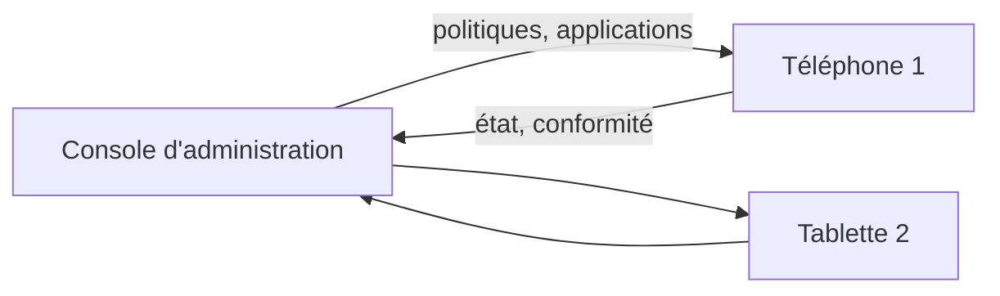

# Cours – Les terminaux mobiles en entreprise

*BTS SIO SISR 1re année – Bloc 1 – S16*

> [!NOTE] Ce que tu dois savoir déjà
> - **Prérequis :** ticket, inventaire de parc, profils d'utilisateurs (S03, S05, S06).
> - **Expliqués dans ce cours :** terminal mobile, BYOD, gestion de flotte (MDM), politique de sécurité, effacement à distance, charte d'usage.

## À la fin de ce cours, tu sauras

- [ ] dire ce qu'est un **terminal mobile** et en quoi sa gestion diffère de celle d'un poste fixe ;
- [ ] distinguer **BYOD**, **appareil fourni** et **appareil fourni à usage mixte** ;
- [ ] décrire ce que fait une solution de **gestion de flotte mobile** ;
- [ ] citer les **règles de sécurité** minimales d'un téléphone professionnel ;
- [ ] décider quoi faire en cas de **perte ou de vol**.

---

## 1. Pourquoi c'est un sujet pour le support ?

Un téléphone ou une tablette professionnelle **contient** la messagerie, les contacts, parfois des documents de l'entreprise, et il **sort** de l'entreprise. Pour le technicien support, cela ajoute :

- des **inventaires** à tenir (modèle, numéro de série, utilisateur, version du système) ;
- des **demandes** nouvelles (« mon téléphone n'a plus la messagerie ») ;
- des **risques** nouveaux : **perte**, **vol**, applications non maîtrisées, réseaux publics.

## 2. Qui possède l'appareil ?

| Modèle | Définition | Avantage | Point d'attention |
|---|---|---|---|
| **Appareil fourni** | L'organisation achète et gère l'appareil, usage professionnel | Contrôle complet | Coût, deux téléphones à porter |
| **Appareil fourni à usage mixte** | L'organisation le fournit, l'usage personnel est toléré | Un seul appareil pour l'utilisateur | Séparer le pro et le perso, définir les règles |
| **BYOD** (*bring your own device*) | L'utilisateur utilise **son** appareil personnel | Peu coûteux | Moins de contrôle, **vie privée** à respecter, matériel hétérogène |

> [!WARNING]
> En BYOD, l'organisation **n'a pas le droit** de lire les données personnelles de l'utilisateur ni de tout effacer sans cadre clair. Les règles se définissent **par écrit** (charte, consentement) et avec le responsable de la protection des données.

## 3. La gestion de flotte mobile (MDM)

Une solution de **MDM** (*mobile device management*) permet de **gérer des appareils à distance** depuis une console.

| Fonction | Ce que cela permet |
|---|---|
| **Inscription** | Enrôler l'appareil : il appartient désormais à la flotte |
| **Politiques** | Imposer un code de verrouillage, le **chiffrement**, une version minimale du système |
| **Applications** | Installer, mettre à jour ou interdire des applications |
| **Inventaire** | Modèle, version, applications installées, dernier contact |
| **Conformité** | Repérer et isoler un appareil qui ne respecte plus la politique |
| **Perte ou vol** | **Verrouiller**, **localiser**, **effacer à distance** (tout ou seulement la partie professionnelle) |

## 4. Les règles de sécurité de base

| Règle | Pourquoi |
|---|---|
| Code de verrouillage et verrouillage automatique | Un appareil perdu ne doit pas s'ouvrir |
| **Chiffrement** du stockage | Les données restent illisibles sans le code |
| Mises à jour du système et des applications | Corriger les failles connues |
| Applications issues de **sources officielles** seulement | Limiter les logiciels malveillants |
| **Séparation** pro et perso | Protéger les données de l'entreprise comme la vie privée |
| Prudence avec les **réseaux Wi-Fi publics** | Les échanges peuvent être observés |

## 5. Si l'appareil est perdu ou volé

Ordre des actions (à adapter à la procédure de l'organisation) :

1. **Déclarer** immédiatement : ouvrir un **ticket prioritaire** (le délai compte).
2. **Verrouiller** l'appareil à distance et **tenter de le localiser**.
3. **Changer** les mots de passe des comptes de l'utilisateur (messagerie en premier).
4. **Effacer à distance** si l'appareil ne revient pas, selon la procédure.
5. **Évaluer** s'il y a eu **fuite de données personnelles** : si oui, alerter le responsable de la protection des données (la notification est une obligation légale).
6. **Documenter** l'incident (ticket, chronologie) et **remplacer** l'appareil.

**Je vérifie.** Un apprenti perd son téléphone personnel, qui reçoit sa messagerie professionnelle. Que fait-il en premier, et que peut faire l'entreprise ?

Voir la réponse

Il **prévient tout de suite** le support (ticket prioritaire) : plus le délai est court, plus le risque baisse. L'entreprise peut **verrouiller** ou **effacer la partie professionnelle** (si l'appareil est géré), **réinitialiser** les mots de passe de la messagerie et **révoquer les sessions** ouvertes.

## 6. Une charte pour cadrer les usages

La **charte d'usage** (ou politique d'utilisation) est un document **signé** qui indique : ce qui est autorisé, ce qui est interdit, ce que l'organisation peut contrôler, ce que l'utilisateur doit faire en cas de perte. Elle protège **les deux côtés**.

## À retenir

- Un terminal mobile est un **poste de travail qui sort de l'entreprise** : inventaire, politique et procédure de perte sont indispensables.
- **BYOD** impose de respecter la **vie privée** de l'utilisateur.
- Un **MDM** impose des **politiques**, **installe** des applications et permet **verrouillage et effacement à distance**.
- **Perte ou vol** : ticket prioritaire, verrouillage, changement de mots de passe, évaluation de la fuite éventuelle de données.

> [!NOTE]
> Ce cours est une **introduction**. Pour une démonstration, si une console de gestion de flotte est disponible dans la salle, l'enseignant peut montrer l'inscription d'un appareil et l'application d'une politique.
